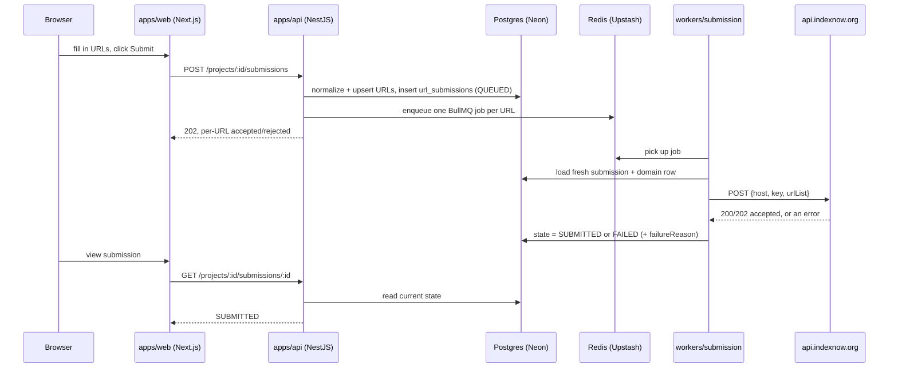

# FoxIndex Architecture (Phase 1 — Walking Skeleton)

## What FoxIndex actually does

FoxIndex is a multi-tenant SaaS for fast, legitimate URL discovery/indexing
submission and index-status monitoring. Phase 1 delivers one thing end to
end, correctly, rather than many things partially:

**Golden path:** sign up → verify email → log in → create an organization
(creator becomes `OWNER`) → create a project → add a domain (server
generates an IndexNow key) → verify the domain (an async worker fetches the
key file with an SSRF-safe client) → submit one or more URLs → the API
validates/normalizes/dedupes/stores them and enqueues a job per URL,
returning `202` → a worker calls the IndexNow provider → the resulting
state (`SUBMITTED` or `FAILED` with a structured reason) is visible in both
the dashboard and the API.

This is deliberately a **walking skeleton**: the repo, database, and module
layout are laid out for the full entity list the product will eventually
need, but business logic exists only where the golden path needs it.
Everything else is listed in [future-modules.md](./future-modules.md) and
[future-schema.md](./future-schema.md) rather than half-built. See
[ADR 0001](./adr/0001-indexnow-only-instant-submission.md) for why "instant
indexing" means IndexNow, and explicitly not a Google bypass.

## Repository layout

```
apps/
  web/        Next.js dashboard — calls apps/api only, never the DB directly
  api/        NestJS API — /api/v1, OpenAPI, response envelope, error taxonomy
workers/
  submission/      BullMQ worker — active (calls the IndexNow provider)
  verification/    BullMQ worker — active (SSRF-safe domain key-file check)
  crawler/, sitemap/, diagnostics/   README stubs only — see future-modules.md
packages/
  types/        enums, submission state machine, job payloads, response envelope
  config/       zod-validated env loading, shared constants
  logger/       pino structured logging with secret redaction
  validation/    Zod schemas per module, URL normalization
  database/      Drizzle schema, migrations, seed, createDbClient()
  auth/          Better Auth server instance (Drizzle adapter), mailer
  queue/         BullMQ queue factories, Redis connection factory, idempotency cache
  providers/     IndexingProvider interface, ProviderRouter, IndexNowProvider
  ssrf-fetch/    safeFetch() — DNS-resolve + IP-range block + connection pinning
infrastructure/
  docker/         docker-compose.dev.yml + Dockerfiles + Caddyfile
  terraform/, cloudflare/   README placeholders — Phase 2+
tests/
  e2e/          Playwright suite driving the whole golden path against live infra
docs/
  this file, future-modules.md, future-schema.md, adr/
```

## Request flow



Domain verification follows the same producer/worker shape: the API
enqueues a `verification` job; `workers/verification` fetches the domain's
key-file URL with `safeFetch`, compares the body to the stored key, and
writes the result back to Postgres. See
[ADR 0003](./adr/0003-domain-verification-as-async-queue.md) for why this
is a real queue and not an inline API call.

## API modules (`apps/api/src/modules`)

`health`, `auth` (Better Auth mounted + `/me`), `organizations`, `projects`,
`domains`, `urls` (read-only — see below), `submissions`, `api-keys`,
`audit-logs` (write path only, no controller yet). Every org-scoped route
goes through `TenantContextGuard` (resolves org/project membership, or an
API key's own scope) then `RolesGuard` (`@Roles(...)` allow-lists).

`urls` is read-only; `submissions` owns the write path — a URL is created
as a side effect of being submitted, not through its own create endpoint.

## Data model (`packages/database/src/schema`)

Every org-scoped table carries `organization_id` (`+ project_id` where
applicable). Tables that exist today:

- `organizations`, `organization_members` (unique `(organization_id, user_id)`)
- `projects` (unique `(organization_id, slug)`)
- `domains` — `hostname`, server-generated `indexnow_key`, optional
  `indexnow_key_location` override, `verification_status`
- `domain_verifications` — append-only attempt log
- `urls` — `raw_url`, `normalized_url`, `normalized_url_hash` (sha256),
  **unique `(project_id, normalized_url_hash)`** (the dedupe constraint)
- `url_submissions` — provider, state, structured `failure_reason`,
  `idempotency_key` (partial unique index, defense-in-depth — see
  [ADR 0004](./adr/0004-idempotency-redis-primary.md))
- `submission_attempts` — append-only per-attempt log (also the durable
  source of truth for failure investigation — see
  [ADR 0005](./adr/0005-no-native-dlq-postgres-source-of-truth.md))
- `api_keys` — prefix + sha256 hash, never plaintext
- `audit_logs` — write path only; no read UI yet, nothing consumes it

Enums: `role` (`OWNER`/`ADMIN`/`MANAGER`/`SEO_MANAGER`/`DEVELOPER`/
`ANALYST`/`VIEWER`/`BILLING` — Phase 1 only actively enforces
OWNER/ADMIN/MANAGER-tier vs. member-tier), `domain_verification_status`
(`PENDING`/`VERIFIED`/`FAILED`), `url_submission_state` (`RECEIVED` →
`VALIDATING` → `ACCEPTED` → `QUEUED` → `PROCESSING` → `SUBMITTED` |
`FAILED`; `MONITORING`/`INDEXED`/`NOT_INDEXED` are modeled but unreachable
in Phase 1 — see [ADR 0001](./adr/0001-indexnow-only-instant-submission.md)),
`submission_provider` (`INDEXNOW` only), `api_key_scope`.

Everything not listed here — teams, index-status history, sitemaps,
automations, webhooks, billing, notifications, OAuth connections — is in
[future-schema.md](./future-schema.md).

## Provider abstraction (`packages/providers`)

`IndexingProvider.submit()` takes URLs + credentials and returns a
normalized `SubmissionResult` (accepted/rejected URLs, an error code,
whether it's retryable). `IndexNowProvider` is the only implementation
registered in Phase 1. Providers make exactly one attempt and never retry
internally — see [ADR 0002](./adr/0002-provider-single-attempt-fail-fast.md)
for why that split (provider = translate one HTTP call; BullMQ = own all
retry/backoff) is what lets a future `GoogleSearchConsoleProvider` (Phase 2,
status-checking only — see future-modules.md) slot in without touching
worker code.

## Queues (`packages/queue`, BullMQ)

All 7 queue names from the constitution are declared as constants
(`submission`, `verification`, `crawler`, `sitemap`, `diagnostics`,
`webhook`, `notification`), but only `submission` and `verification` have
an actual `Queue` + `Worker` running in Phase 1 — no idle Redis connections
for work that doesn't exist yet.

## SSRF-safe fetch (`packages/ssrf-fetch`)

`safeFetch()` resolves DNS itself, rejects any result in a private/
loopback/link-local/metadata IP range, **pins the connection to the
validated IP** (closing a DNS-rebinding TOCTOU gap), and re-validates every
redirect hop manually rather than following them automatically. It's used
by the verification worker (fetching a user-supplied hostname) but
deliberately *not* by `IndexNowProvider` (a fixed, developer-configured
endpoint, not user input). A test-only escape hatch exists — see
[ADR 0007](./adr/0007-ssrf-test-escape-hatch.md).

## What's live-verified vs. what isn't

Live-verified against real infrastructure (Neon Postgres, Upstash Redis,
the real IndexNow API), including a full browser-driven Playwright run of
the entire golden path (`tests/e2e/golden-path.spec.ts` —
[ADR](./adr) references throughout this doc point at decisions that run
survived contact with):

- Signup → email verification (via MailDev) → login → org/project/domain
  creation → domain verification → URL submission → `SUBMITTED`, all
  through the real browser UI, hitting the real API, real DB, real Redis.
- Idempotency-key replay, dual session/API-key auth with scope enforcement,
  retry-exhaustion → `FAILED`, SSRF blocking with the Happy-Eyeballs fix.

**Not** live-verified — written and statically validated
(typecheck/lint/build all pass) but never actually executed, and that's
stated here rather than glossed over:

- **Docker** (`infrastructure/docker/`) — this development environment has
  no Docker daemon available (Docker Desktop requires virtualization
  support not present in this VM). The compose files, Dockerfiles, and
  Caddy config are written and internally consistent but unrun.
- **GitHub Actions CI** (`.github/workflows/`) — there is no GitHub remote
  for this repo (git is local-only per project decision). The workflows are
  structurally validated (same steps run locally via `pnpm turbo run
  <task>`, which does pass) but the workflow YAML itself has never executed
  on GitHub's runners.

## Dependency injection: a real, documented gotcha

Two NestJS + `tsx` + esbuild-specific bugs were found live and turned into
project-wide conventions — see
[ADR 0006](./adr/0006-nestjs-explicit-dependency-injection.md). The short
version: every constructor-injected parameter in `apps/api` gets an
explicit `@Inject(Token)`, and any class used via `@UseGuards()` that is
*also* injected elsewhere via `@Inject()` must be registered in that
module's `providers` array. Both were invisible under `tsc` and only
surfaced under `tsx watch` (the dev runtime) or via Nest's guard
instantiation semantics — the kind of thing that's easy to reintroduce
without the ADR.
